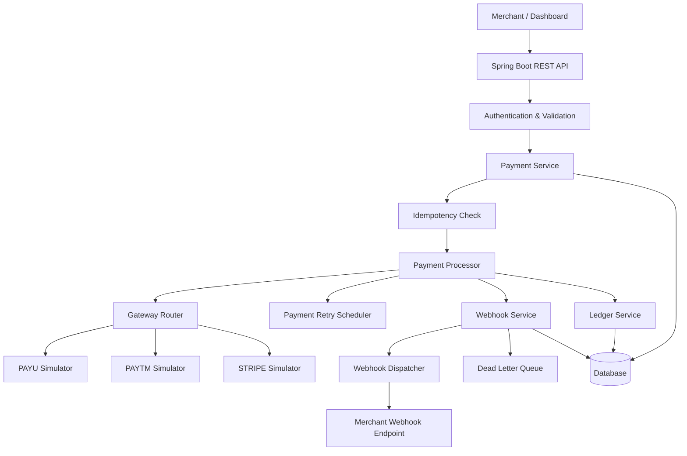

# Payment Orchestration Service

A Spring Boot-based payment orchestration backend designed around production fintech engineering patterns. It demonstrates multi-gateway routing, fault tolerance, idempotent payment APIs, asynchronous retries, signed webhooks, and double-entry ledger accounting.

**Live Demo:** https://payment-orchestration-5vnz.onrender.com/app/

**Backend Health:** https://payment-orchestration-5vnz.onrender.com/actuator/health

## Architecture



## Core Features

| Capability | Implementation |
|---|---|
| Multi-gateway routing | `GatewayRouter` routes through PAYU, PAYTM, and STRIPE in configured priority order. Transient failures trigger failover; hard declines stop routing. |
| Circuit breaker | Three consecutive transient failures open a gateway circuit for 30 seconds. Open gateways are skipped. |
| Idempotency | Unique `(merchant, idempotencyKey)` constraint. Matching requests replay the original payment; conflicting payloads return HTTP 409. Concurrent insert races are handled through the database uniqueness constraint. |
| Payment retries | Exponential backoff with jitter. Failed payments enter `RETRY_SCHEDULED`; retry exhaustion transitions them to `EXHAUSTED`. |
| Optimistic locking | JPA `@Version` prevents concurrent workers from processing the same payment version. |
| Signed webhooks | HMAC-SHA256 signatures, exponential delivery retries, and dead-letter handling after five attempts. |
| Webhook replay | Administrators can replay dead-letter webhook events. |
| Double-entry ledger | Successful captures create balanced debit and credit entries for customer funds, merchant payable, and platform revenue. |
| Reconciliation | Merchant-level reconciliation of captures, ledger entries, fees, and net settlement. |
| Gateway simulation | Runtime gateway modes: `UP`, `FLAKY`, `DOWN`, and `DECLINE`. |
| Authentication | API-key authentication using `X-ADMIN-KEY` and `X-API-KEY`. |
| Error handling | Centralized exception handling through `GlobalExceptionHandler`. |

## Payment Lifecycle

1. A merchant submits a payment request with an idempotency key.
2. The service checks whether the request has already been processed.
3. A new payment is passed to the payment processor.
4. The gateway router attempts payment through configured providers.
5. Transient failures trigger gateway failover.
6. Successful payments generate double-entry ledger records.
7. Failed transient payments are scheduled for retry.
8. Webhook events are generated and dispatched to merchant endpoints.
9. Failed webhook deliveries are retried and eventually moved to the dead-letter queue.

## Technology Stack

- **Language:** Java 21
- **Framework:** Spring Boot 3
- **Persistence:** Spring Data JPA, Hibernate
- **Databases:** H2 (local development), PostgreSQL (production)
- **Security:** Spring Security, API-key authentication
- **Build:** Maven
- **Testing:** JUnit 5, Spring Boot Test, MockMvc
- **Deployment:** Docker, Render
- **Frontend:** Spring Boot-served web console

## API Endpoints

### Admin APIs

Authentication header: `X-ADMIN-KEY`

| Method | Endpoint | Purpose |
|---|---|---|
| POST | `/api/v1/admin/merchants` | Create merchant |
| GET | `/api/v1/admin/reconciliation/{merchantId}` | Reconcile merchant ledger |
| GET | `/api/v1/admin/webhooks/dead-letter` | View dead-letter webhooks |
| POST | `/api/v1/admin/webhooks/{id}/replay` | Replay webhook |
| GET | `/api/v1/admin/gateways` | View gateway status |
| PUT | `/api/v1/admin/gateways/{gateway}` | Change gateway mode |

Example gateway configuration:

```json
{
  "mode": "DOWN"
}
```

Supported gateway modes: `UP`, `FLAKY`, `DOWN`, `DECLINE`.

### Merchant APIs

Authentication header: `X-API-KEY`

| Method | Endpoint | Purpose |
|---|---|---|
| POST | `/api/v1/merchant/payments` | Create payment |
| GET | `/api/v1/merchant/payments` | List payments |
| GET | `/api/v1/merchant/payments/{id}` | Get payment details |
| POST | `/api/v1/merchant/payments/{id}/force-retry` | Trigger payment retry |

### Webhook Receiver

`POST /webhook-sink` — demo webhook receiver.

## Running Locally

### Prerequisites

- Java 21
- Maven 3.8+
- Git

### Clone the repository

```bash
git clone https://github.com/anushkasinha/payment-orchestration-service.git
cd payment-orchestration-service
```

### Run the application

```bash
mvn spring-boot:run
```

Open the console:

```text
http://localhost:8080/app/
```

The default local configuration uses an in-memory H2 database.

### Run tests

```bash
mvn clean verify
```

## Configuration

The application supports environment-based configuration.

| Variable | Purpose |
|---|---|
| `PORT` | Application server port |
| `ADMIN_KEY` | Administrator API key |
| `SEED_MERCHANT_KEY` | Seed merchant API key |
| `DB_HOST` | PostgreSQL host |
| `DB_PORT` | PostgreSQL port |
| `DB_NAME` | PostgreSQL database name |
| `DB_USER` | PostgreSQL username |
| `DB_PASSWORD` | PostgreSQL password |
| `WEBHOOK_ALLOW_PRIVATE` | Allow private webhook destinations |

For production, activate the `prod` Spring profile:

```text
SPRING_PROFILES_ACTIVE=prod
```

Keep credentials in environment variables or your deployment platform's secret manager. Never commit real API keys or database credentials.

## Deployment

The application is containerized using Docker and deployed on Render.

- Spring Boot backend and dashboard are served from the same application.
- PostgreSQL is provisioned as a separate database resource.
- Production database credentials are injected through environment variables.
- Application health is exposed through `/actuator/health`.

**Live application:** https://payment-orchestration-5vnz.onrender.com/app/

## Design Decisions

- **Idempotency:** Prevents duplicate payment creation when clients retry requests.
- **Gateway failover:** Improves resilience when a payment provider experiences transient failures.
- **Circuit breakers:** Avoid repeatedly calling unhealthy gateways.
- **Exponential backoff:** Reduces repeated pressure on unavailable services.
- **Double-entry accounting:** Maintains balanced ledger entries for successful captures.
- **Signed webhooks:** Allows receivers to verify webhook authenticity.
- **Optimistic locking:** Protects payment processing against concurrent updates.

## Limitations and Future Improvements

- Gateway integrations currently use simulated providers; real provider SDK integrations are not included.
- Database schema management can be strengthened with versioned migrations such as Flyway.
- Production observability can be extended with metrics, dashboards, and distributed tracing.
- Additional integration and concurrency tests can further strengthen reliability.

---

**Built with Java 21 and Spring Boot.**